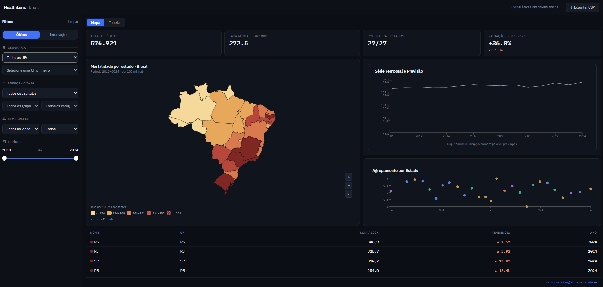
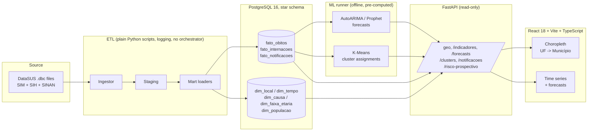

# HealthLens


[](https://github.com/YagoCalomino/HealthLens/actions/workflows/ci.yml)

**[Live demo](https://health-lens-virid.vercel.app)** (first load ~20s) · [Architecture](#architecture) · [Data quality](#data-quality)

| | |
|---|---|
| Sources | SIM (mortality) 2015–2023, SIH (admissions) 2015–2023, SINAN (notifiable diseases) 2015–2023 |
| Volume | 9.2M+ SINAN notifications |
| Model | PostgreSQL 16 star schema: 3 fact tables, 5 dimensions, materialized views |
| Pipeline | Idempotent Python ETL (`.dbc` → staging → marts), Alembic migrations |
| Quality | CI: pytest (≥70% coverage), Alembic drift check, query-time budgets, completeness allowlist |
| Serving | Read-only FastAPI (cursor pagination), React + Vite choropleth |

> ⚠️ **Demo database:** partial dataset (free-tier storage limit of ~500 MB). Full load covers all states and years; runs locally or on a paid tier.

I built HealthLens to turn Brazil's raw DataSUS public-health microdata into
something an analyst or health manager can actually act on: per-100k rates,
short-horizon forecasts with confidence intervals, and municipality clusters
grouped by epidemiological profile. The raw inputs are the `.dbc` files behind
SIM (mortality), SIH (hospital admissions) and SINAN (notifiable diseases), a
legacy dBase/pkzip format that most tooling won't touch directly. It's also my
portfolio piece for demonstrating end-to-end data engineering on a real, messy
public dataset instead of a toy one.



## The problem

Getting from "raw DataSUS file dump" to "I can compare mortality trends across
municípios and see where they're heading" requires cleaning revision cycles out
of the mortality records, deduplicating hospital admissions correctly, joining
against population estimates to get real rates instead of raw counts, and
presenting all of it geographically (state to municipality) and over time.
HealthLens is my answer to that pipeline, end to end.

## How it works

The core is a **star schema** with three fact tables: `fato_obitos` (deaths, from
SIM), `fato_internacoes` (hospital admissions, from SIH) and `fato_notificacoes`
(notifications, from SINAN). I kept them separate because the sources have
genuinely different dimensionality.
`causa_basica` makes sense for deaths; procedure/AIH data makes sense for
admissions. Forcing them into one wide table would have meant a sparse mess.
The `taxa_por_100k` column is computed at load time against `dim_populacao`,
so the API never joins against population data at query time. The ETL does that
math once and stores the result.

One thing that cost me a week: `dim_local` carries **two IBGE codes per
município**. `codigo_ibge_6` is DataSUS's own 6-digit FK; `codigo_ibge_7` is
the 7-digit code with a check digit, which is what IBGE's TopoJSON files use.
Keeping both avoids a whole class of bug where a 6 vs 7-digit mismatch
silently breaks the choropleth for exactly one município, no error, no warning,
just a missing polygon.

The ML side runs entirely offline. A batch runner pre-computes AutoARIMA /
Prophet forecasts and K-Means cluster assignments and writes the results into
Postgres. The API only ever reads those rows and never runs a model at request
time. Worst case if a forecast job blows up: a stale row. The API stays up.

The map is two-level by design. The national view renders 27 UF paths.
Municipality-level TopoJSON for a given state is fetched only when the user
drills into it. Loading all ~5,570 municipality polygons upfront made the map
visibly janky in early testing, so each state now loads lazily on drill-down.

Every environment-specific value (`DATABASE_URL`, `CORS_ORIGINS`,
`VITE_API_BASE_URL`) lives in an environment variable. Zero hardcoded
`localhost`. That was a day-one constraint because it's the difference between
"runs on my machine" and "deployable without a rewrite."

## Architecture



The ingestor reads raw SIM (`DO*.dbc`), SIH (`RD*.dbc`) and SINAN
(notifiable-disease notifications: dengue, chikungunya and venomous animals)
files and stages them as plain DataFrames. The only transforms at this step
are the ones needed to make the source data trustworthy: SIM revision-cycle deduplication and SIH
`IDENT=1` filtering. Mart loaders then upsert staged rows into the dimension
and fact tables, computing `taxa_por_100k` in the same pass. The ML runner
reads from the fact tables, writes forecasts and cluster assignments back, and
FastAPI serves everything through a cursor-paginated read-only API. The React
dashboard consumes that API to drive the choropleth drill-down and time-series
views.

Current data coverage: SIM 2015–2023, SIH 2015–2023, SINAN 2015–2023.

## Data quality

Most of the work in this project went into making the loaded numbers match the
official totals. The checks live in one of three places: staging (rules that
make the source trustworthy), the database (constraints) and CI.

**SIM revision cycles.** SIM republishes death records across revision cycles,
so the same death certificate can arrive more than once. The `fato_obitos`
upsert key is `(numero_do, revisao_numero)`, backed by a unique index, so
reloading a revised file updates rows instead of duplicating them.

**SIH `IDENT=1`.** `pysus` 2.2.0 (the version I started with; the project now pins 2.7.0) concatenates the SIH-RD
(AIH/admission) and SIH-SP (procedure) record groups into a single DataFrame.
`SP_TIPO` looks like the obvious incident-admission flag, but it belongs only
to the SP group and is always null on genuine AIH rows. Filtering on it
silently drops every real admission. The correct discriminator is `IDENT=1`,
applied at staging.

**Completeness allowlist.** `scripts/assert_sim_completeness.py`,
`assert_sih_completeness.py` and `assert_sinan_completeness.py` check that every
expected state/year (or agravo/year) has data. Pairs that are genuinely missing
or partial in the source are listed in `scripts/*_allowlist.yaml` as
`known_absent` / `known_partial`, so the check only fails on unexplained gaps.

The SINAN load surfaced two bugs. While loading a full year of dengue notifications, the row counts were about 32% lower than expected. The SINAN ingestor processes files in 200k-row batches and generates an ordinal key per row to guarantee uniqueness during upsert. That counter was resetting to zero at the start of each batch, so batch two's rows were silently overwriting batch one's. Carrying each key's running count across batches (equivalent to a single `cumcount()` over the full frame) fixed it; that year's dengue load went from about 1.1 million to 1.6 million rows after the fix.

Finding that bug led to auditing the known-absent allowlist, which flags agravo/year pairs believed missing from the source so the completeness check stops flagging them as missing. Four entries were wrong: DENG 2021, DENG 2022, CHIK 2017 and CHIK 2019 had been marked absent because of a `pysus` path collision. When a file is available on both the FTP and dadosgov origins, both downloads target the same local path and the second overwrites the first before it's been read. The four files appeared missing because they'd been corrupted mid-download. With the fix applied, all four recovered cleanly and added over 2.3 million notifications that were missing from the database.

**Query-time budgets.** `scripts/check_query_budgets.py` runs
`EXPLAIN (ANALYZE)` on the five queries the dashboard issues against a seeded
PostgreSQL instance and fails CI if any exceeds 200 ms (the `/indicadores` p50
target).

**Alembic drift check.** CI runs `alembic check`, which fails if the SQLAlchemy
models and the migration history have diverged (a schema change without a
migration).

## Quick start

**Fast path: sample mode, no PostgreSQL.**
Runs the pipeline against a small committed synthetic Parquet sample in `data/sample/`,
good for a first look or for CI:

```bash
make sample
cd backend && SAMPLE_MODE=true CORS_ORIGINS=http://localhost:5173 uvicorn app.main:app --reload
```

**Full stack: Docker Compose.**
Brings up PostgreSQL, runs migrations, starts the API and frontend containers:

```bash
cp .env.example .env   # adjust the variables as needed
docker compose up
```

Or drive the steps individually:

```bash
make up      # start PostgreSQL 16 + run Alembic migrations
make seed    # load CID-10, IBGE municípios, TCU population, faixa_etária seeds
make full    # download DataSUS, run the ETL pipeline, refresh MVs, run ML runners
```

```bash
make test    # pytest, sample mode, --cov-fail-under=70
make lint    # ruff + mypy (backend) + frontend build
```

## Notebooks

The three notebooks in `notebooks/` run on real SIM data for São Paulo, Rio de Janeiro and
Minas Gerais, not on the synthetic sample. `scripts/build_notebook_extract.py` aggregates the
raw DataSUS files by município, year, ICD-10 group, sex and age band, joins the TCU
population and writes `data/notebooks/sim_agregado.parquet` (3 MB, 955,555 rows covering
5,012,726 deaths from 2015 to 2022). Counts are exact, so every rate matches the full
microdata.

- **01_eda**: mortality for 2019-2022, 2.7 million deaths across 1,590 municípios. COVID-19
  pushes SP from 676 to 945 deaths per 100k between 2019 and 2021.
- **02_forecasting**: AutoARIMA vs Prophet, trained on 2015-2020 and validated on 2021-2022.
  AutoARIMA beats a naive baseline in 26% of municípios but not on the median (MASE 2.15 vs
  1.81), because the validation years are the pandemic peak and its drop.
- **03_clustering**: K-Means (k=6) on 1,590 municípios for 2022, silhouette 0.15. The
  production runner clusters all 5,570 municípios with a fifth feature (the SIH
  hospitalization rate), so its groups and labels differ from the notebook's.

## Known limitations

**The forecast horizon has partly passed.** The AutoARIMA/Prophet models were
trained on data through 2023/2024, so the 2024-2027 window shown in the
dashboard is now partially historical. Treat it as a demonstration of the
forecasting methodology. The models can be retrained against fresher DataSUS
data whenever it's pulled.

**At-risk population indicators aren't in v1.** Violence victims and LGBTQ+
health indicators require additional DataSUS sources. I scoped v1 to SIM, SIH
and SINAN (dengue, chikungunya and venomous animals) to get the star schema and
ML pipeline right first. They're the natural
next milestone.

## How I built this

The engineering decisions were mine: the dimensional model, the DataSUS domain rules (SIH `IDENT=1`, SIM revision cycles, the population fan-out fixed in migration 0015), the data-quality checks, and validating every number against official totals. Every bug described above was found by me, by comparing loaded counts against the source.

## License

MIT. See [LICENSE](LICENSE).

> Developed in a private repository and published here with a clean history. Development continues in this repo.
